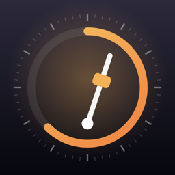
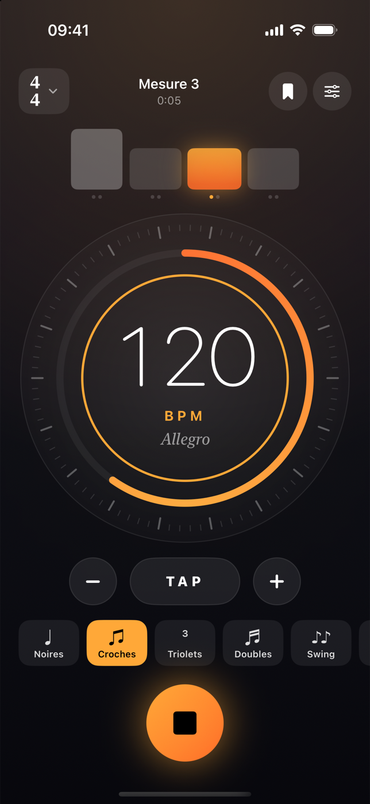
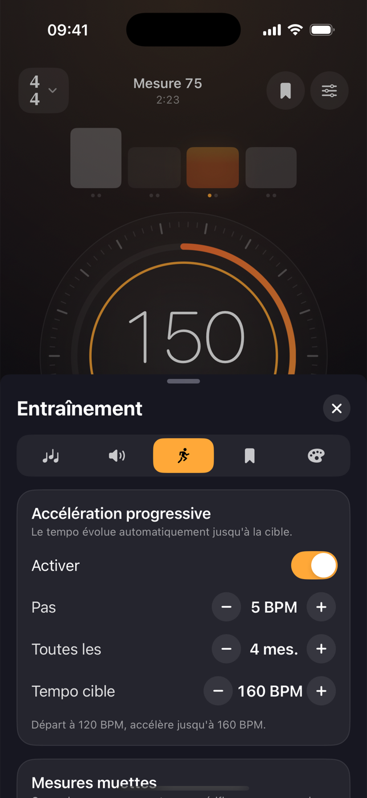
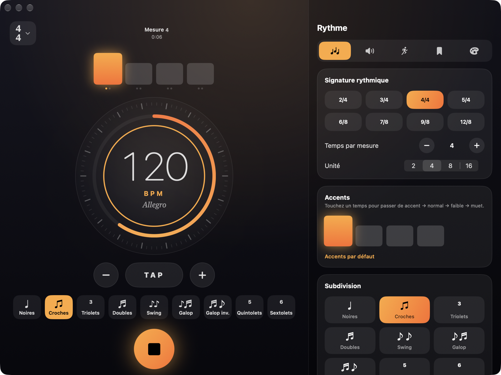
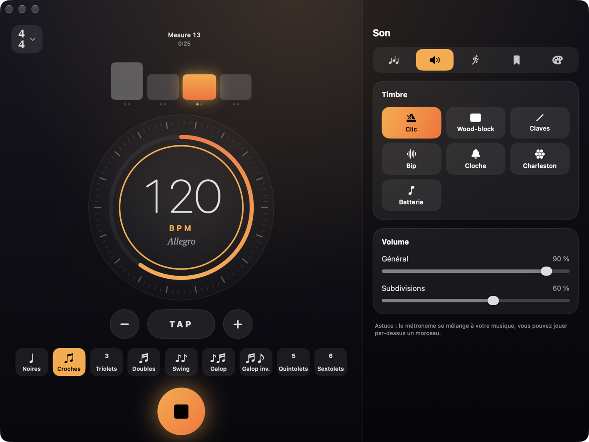

<p align="center">
  
</p>

<h1 align="center">Métronome</h1>

<p align="center">
  Un métronome complet, simple et élégant pour <b>iPhone, iPad et Mac</b>.<br>
  100 % SwiftUI natif, moteur audio précis à l'échantillon, aucun fichier son.
</p>

<p align="center">
  
  
  
  
</p>

<p align="center">
  
  &nbsp;&nbsp;
  
</p>

<p align="center">
  
</p>

## Fonctionnalités

**Tempo**
- 20 à 400 BPM : cadran rotatif (tourner pour régler, toucher pour démarrer), boutons ± avec répétition, **tap tempo**
- Indication italienne en direct (Adagio, Andante, Allegro, Presto…)

**Rythme**
- Signatures de 2/4 à 12/8, de 1 à 16 temps par mesure, unités 2/4/8/16
- **Accents par temps** : touchez une barre pour passer de accent → normal → faible → muet
- Accents par défaut intelligents pour les mesures composées et impaires (6/8, 7/8 en 2+2+3, 5/8 en 3+2…)
- **Subdivisions** : croches, triolets, doubles, swing réglable (50–80 %), galop, galop inversé, quintolets, sextolets — avec volume indépendant

**Son**
- 7 timbres synthétisés : clic, wood-block, claves, bip, cloche, charleston, batterie
- Sur iOS : lecture en arrière-plan et mélange avec votre musique (jouez par-dessus un morceau)

**Entraînement**
- **Accélération progressive** : +N BPM toutes les N mesures jusqu'à un tempo cible (ou décélération)
- **Mesures muettes** : X mesures jouées, Y mesures de silence, pour vérifier que vous tenez le tempo
- **Minuteur** de séance, compteur de mesures et temps écoulé

**Confort**
- Préréglages (un par morceau ou exercice), 6 thèmes de couleur
- Flash visuel sur le 1er temps, vibrations sur les temps (iPhone)
- L'écran ne se met pas en veille pendant la lecture
- Mise en page deux colonnes sur Mac et iPad, raccourcis clavier sur Mac

| Touche | Action |
|---|---|
| Espace | Démarrer / arrêter |
| ↑ ↓ | Tempo ± 1 |
| ← → | Tempo ± 10 |
| T | Tap tempo |

<p align="center">
  
</p>

## Comment c'est fait

- **Moteur audio** : un `AVAudioSourceNode` génère les clics directement dans le flux audio, à l'échantillon près. Pas de minuterie : aucune dérive, même à 400 BPM en sextolets.
- **Ordonnanceur pur** (`TickScheduler`) : sans dépendance audio, testé unitairement (tempo, subdivisions, swing, accélération, mesures muettes, indépendance à la taille des buffers).
- **Synchronisation visuelle** : chaque temps est horodaté en échantillons ; l'interface l'affiche au moment où il sort réellement du haut-parleur (latence de sortie compensée).
- **Sons** : synthèse additive / bruit filtré à la volée (`ClickSynth`), donc aucun fichier audio dans l'app.
- Le fil audio ne bloque jamais : échanges avec l'interface via un verrou `tryLock` (`OSAllocatedUnfairLock`).

```
Metronome/
├── App/          Point d'entrée, menus
├── Audio/        TickScheduler, ClickSynth, MetronomeAudioEngine
├── Controller/   MetronomeController (@Observable), retours haptiques
├── Model/        Réglages, signatures, préréglages, tap tempo
└── Views/        Cadran, barres de temps, panneau de réglages, thème
```

## Compiler

Prérequis : Xcode 16+ et [XcodeGen](https://github.com/yonaskolb/XcodeGen) (`brew install xcodegen`).

```bash
git clone https://github.com/floZx/metronome.git
cd metronome
xcodegen generate
open Metronome.xcodeproj
```

Choisissez « My Mac » ou votre iPhone comme destination, puis ▶. Pour un iPhone, remplacez `DEVELOPMENT_TEAM` dans `project.yml` par votre propre équipe.

Tests :

```bash
xcodebuild test -project Metronome.xcodeproj -scheme Metronome -destination 'platform=macOS'
```

L'icône est dessinée en code : `swift scripts/make_icon.swift icon.png`.

## Licence

[MIT](LICENSE)
